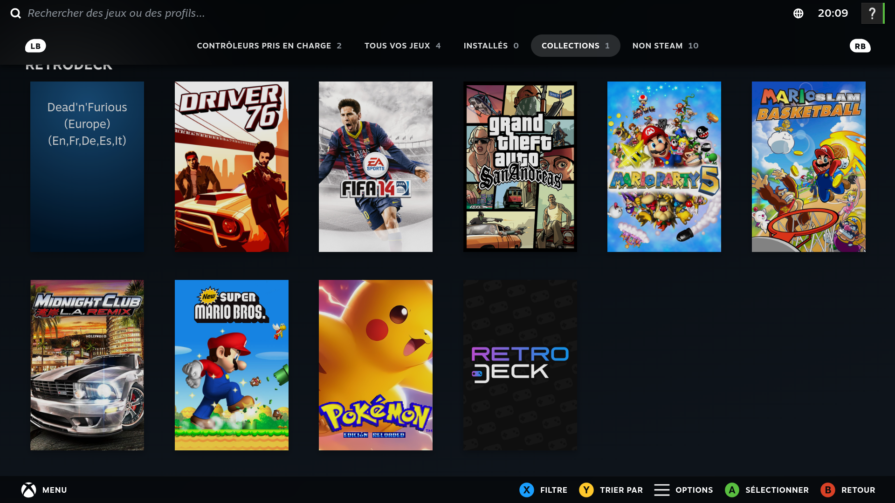

# EliteDesk Bazzite : console rétro, streaming et serveur maison

[](Images/01-bibliotheque-steam.png)

Journal d'installation de mon **HP EliteDesk 800 G3 Mini** sous **Bazzite** (Fedora Atomic), transformé en :

- 🎮 **console** : Steam Big Picture au démarrage, RetroDECK pour l'émulation (DS, PSP, PS2…) ;
- 📡 **serveur de streaming** : Sunshine (capture KMS + encodage VA-API) vers Moonlight sur mon PC portable ;
- 🛠️ **serveur de dev** : [Dev Studio](https://github.com/yacinehrc/Dev_Studio) (Nginx, PHP 8.2, MariaDB, Node 20) dans un conteneur Podman ;
- 💾 **NAS** : volume Btrfs de 2,8 To sur un DAS USB de 3 disques, partagé en Samba ;
- 🌡️ **supervision** : Glances, smartd, mise en veille des disques et alertes sur le téléphone (ntfy) ;
- 🔐 **accès à distance** : Tailscale + SSH par clé.

> Réalisé les 19 et 20 novembre 2026. Les commandes ci-dessous sont **celles qui ont réellement été exécutées**, dans l'ordre, avec les problèmes rencontrés et leurs solutions.

---

## Sommaire

1. [Matériel](#1-matériel)
2. [Architecture](#2-architecture)
3. [Installation de Bazzite](#3-installation-de-bazzite)
4. [Accès à distance : Tailscale, SSH, veille](#4-accès-à-distance--tailscale-ssh-veille)
5. [Pare-feu](#5-pare-feu)
6. [Dev Studio (Podman + Quadlet)](#6-dev-studio-podman--quadlet)
7. [Glances](#7-glances)
8. [Stockage : DAS en Btrfs 2,8 To](#8-stockage--das-en-btrfs-28-to)
9. [NAS Samba](#9-nas-samba)
10. [Sauvegarde nocturne](#10-sauvegarde-nocturne)
11. [Disques : veille, surveillance, alertes ntfy](#11-disques--veille-surveillance-alertes-ntfy)
12. [Réglages KDE](#12-réglages-kde)
13. [Sunshine (streaming) : du Flatpak à la version Brew](#13-sunshine-streaming--du-flatpak-à-la-version-brew)
14. [Moonlight (client)](#14-moonlight-client)
15. [RetroDECK et les jeux](#15-retrodeck-et-les-jeux)
16. [Steam et la bibliothèque façon console](#16-steam-et-la-bibliothèque-façon-console)
17. [Récapitulatif services et ports](#17-récapitulatif-services-et-ports)
18. [Maintenance](#18-maintenance)

---

## 1. Matériel

| Élément | Détail |
|---|---|
| Machine | HP EliteDesk 800 G3 Mini (version 65 W) |
| Processeur | Intel Core i5-6500 (4 cœurs), iGPU Intel HD 530 |
| RAM | 8 Go DDR4 SO-DIMM, **une seule barrette** (DIMM1, canal B), DIMM3 libre |
| Disque système | SSD SATA Samsung MZ7LN256 (256 Go), `sda` |
| DAS USB (3 × 1 To) | WD Blue WD10EZEX (`sdb`), Seagate ST1000LM035 2,5" (`sdc`), WD Green WD10EADS (`sdd`) |
| Réseau | Ethernet Intel I219-LM (`eno1`), Wi-Fi/Bluetooth Intel |
| Écran | KTC M24 en DisplayPort (DP-2), 1920×1080 |
| IP locale | `192.168.1.16` |

---

## 2. Architecture

```
                        ┌──────────────── EliteDesk (Bazzite 45, KDE Wayland) ────────────────┐
 PC portable            │                                                                      │
 (Moonlight, SSH) ──────┤ Tailscale (100.x.y.z)    eno1 (192.168.1.16)                        │
                        │                                                                      │
                        │  Steam Big Picture ── RetroDECK (ES-DE, PPSSPP, melonDS, PCSX2…)     │
                        │  Sunshine (Brew, KMS + VA-API)  ──► stream vers Moonlight            │
                        │                                                                      │
                        │  Podman (Quadlet, rootful)                                           │
                        │   ├─ dev-server : Debian 12 + systemd (Nginx, PHP 8.2, MariaDB, Node)│
                        │   └─ glances    : supervision web (port 61208)                       │
                        │                                                                      │
                        │  Samba : NAS / Data / Jeux     smartd + alertes ntfy                 │
                        │                                                                      │
                        │  SSD 256 Go : système, Steam, RetroDECK, /var/srv/devstudio          │
                        │  DAS 3×1 To : Btrfs « DATA » 2,8 To → /var/mnt/data                  │
                        └──────────────────────────────────────────────────────────────────────┘
```

---

## 3. Installation de Bazzite

- Image : **Bazzite Desktop, KDE Plasma, GPU Intel** (sans le « Steam Gaming Mode », qui n'est pas pris en charge officiellement sur les puces Intel HD).
- Installé sur le **SSD interne** avec le partitionnement automatique.

---

## 4. Accès à distance : Tailscale, SSH, veille

```bash
which tailscale                         # /usr/bin/tailscale (inclus dans Bazzite)
sudo systemctl enable --now tailscaled
sudo tailscale up                       # se connecter via le lien affiché
sudo hostnamectl set-hostname elitedesk

# Un serveur ne doit pas se mettre en veille
sudo systemctl mask sleep.target suspend.target hibernate.target hybrid-sleep.target
systemctl status sleep.target           # masked
systemctl is-enabled tailscaled         # enabled
```

**Clé SSH depuis le PC Windows** (PowerShell, en réutilisant une clé déjà existante pour ce PC suite à plusieurs configurations antérieures) :

```powershell
type $env:USERPROFILE\.ssh\id_XXXX.pub | ssh yacine@100.x.y.z "mkdir -p ~/.ssh && cat >> ~/.ssh/authorized_keys && chmod 700 ~/.ssh && chmod 600 ~/.ssh/authorized_keys"
```

---

## 5. Pare-feu

```bash
sudo firewall-cmd --state
sudo firewall-cmd --permanent --zone=trusted --add-interface=tailscale0
sudo firewall-cmd --permanent --add-service=ssh --add-service=samba --add-service=http
sudo firewall-cmd --permanent --add-port=5173/tcp --add-port=61208/tcp
sudo firewall-cmd --permanent --add-port=47984/tcp --add-port=47989/tcp --add-port=47990/tcp --add-port=48010/tcp
sudo firewall-cmd --permanent --add-port=47998-48000/udp --add-port=48002/udp --add-port=48010/udp
sudo firewall-cmd --reload
sudo firewall-cmd --list-all
```

> La zone par défaut `FedoraWorkstation` ouvre déjà les ports 1025 à 65535 : d'où les messages `ALREADY_ENABLED`. Aucun port n'est ouvert sur la box : l'accès extérieur passe uniquement par Tailscale.

---

## 6. Dev Studio (Podman + Quadlet)

Remplace l'ancien conteneur LXC 105 de mon projet [Dev Studio](https://github.com/yacinehrc/Dev_Studio) par un conteneur **Debian 12 avec systemd**, géré par **Quadlet** (démarrage automatique).

```bash
sudo mkdir -p /var/srv/devstudio/{www,data,mysql}
sudo chattr +C /var/srv/devstudio/mysql      # pas de copie-sur-écriture Btrfs pour MariaDB
mkdir -p ~/devstudio
cat > ~/devstudio/Containerfile <<'EOF'
FROM docker.io/library/debian:12
ENV container=podman
RUN apt-get update && apt-get install -y --no-install-recommends \
      systemd systemd-sysv dbus ca-certificates curl sudo locales procps \
 && apt-get clean && rm -rf /var/lib/apt/lists/*
STOPSIGNAL SIGRTMIN+3
CMD ["/sbin/init"]
EOF
sudo podman build -t localhost/devstudio-base:12 ~/devstudio
```

`/etc/containers/systemd/dev-server.container` :

```ini
[Unit]
Description=Dev Studio - Debian 12
Wants=network-online.target
After=network-online.target

[Container]
Image=localhost/devstudio-base:12
ContainerName=dev-server
HostName=dev-server
PublishPort=80:80
PublishPort=5173:5173
Volume=/var/srv/devstudio/www:/var/www:Z
Volume=/var/srv/devstudio/data:/var/lib/devstudio:Z
Volume=/var/srv/devstudio/mysql:/var/lib/mysql:Z
Environment=TZ=Europe/Paris
PodmanArgs=--systemd=always

[Service]
Restart=always
TimeoutStartSec=300

[Install]
WantedBy=multi-user.target
```

```bash
sudo systemctl daemon-reload
sudo systemctl start dev-server
sudo podman ps

curl -fsSLo ~/devstudio/devstudio-install.sh \
  https://github.com/yacinehrc/Dev_Studio/raw/refs/heads/main/Script/devstudio-install.sh
sudo podman cp ~/devstudio/devstudio-install.sh dev-server:/root/
sudo podman exec -it dev-server bash /root/devstudio-install.sh
```

Résultat : PHP 8.2, Node v20.20.2, MariaDB 10.11.19. nginx, php8.2-fpm et mariadb sont actifs, et le tableau de bord répond (HTTP 200) sur `http://<ip>/dashboard/`.

> Le réseau `10.88.x.x` (`podman0`) est le réseau interne de Podman : les ports 80 et 5173 sont redirigés vers le conteneur.

---

## 7. Glances

`/etc/containers/systemd/glances.container` :

```ini
[Unit]
Description=Glances
Wants=network-online.target
After=network-online.target

[Container]
Image=docker.io/nicolargo/glances:latest-full
ContainerName=glances
Network=host
PodmanArgs=--pid=host
SecurityLabelDisable=true
Environment=GLANCES_OPT=-w
Environment=TZ=Europe/Paris
Volume=/etc/os-release:/etc/os-release:ro

[Service]
Restart=always

[Install]
WantedBy=multi-user.target
```

```bash
sudo systemctl daemon-reload
sudo systemctl start glances
```

Interface web : `http://<ip>:61208`. CPU entre 26 et 33 °C au repos.

---

## 8. Stockage : DAS en Btrfs 2,8 To

Inventaire et vérifications **avant** de toucher aux disques :

```bash
lsblk -o NAME,SIZE,MODEL,TRAN,FSTYPE,LABEL
findmnt -no SOURCE /sysroot                 # /dev/sda3 : le système tourne bien sur le SSD
sudo dmidecode -t memory | grep -E "Size:|Locator:" | grep -v "No Module"
for d in sdb sdc sdd; do echo "== $d"; sudo smartctl -d sat -H -A /dev/$d | grep -Ei "result|Temperature_Celsius|Reallocated_Sector|Power_On_Hours"; done
```

Bilan SMART : 3 × PASSED, 0 secteur réalloué, 33 à 35 °C.

Création d'un volume **Btrfs unique** (données en `single`, métadonnées en `raid1`) :

```bash
sudo wipefs -a /dev/sdb /dev/sdc /dev/sdd
sudo mkfs.btrfs -f -L DATA -d single -m raid1 /dev/sdb /dev/sdc /dev/sdd

sudo mkdir -p /var/mnt/data
sudo chattr +i /var/mnt/data      # empêche d'écrire sur le SSD si le DAS n'est pas monté
echo "LABEL=DATA /var/mnt/data btrfs defaults,noatime,compress=zstd:1,nofail,x-systemd.device-timeout=30s 0 0" | sudo tee -a /etc/fstab
sudo systemctl daemon-reload
sudo mount /var/mnt/data
sudo chown $USER:$USER /var/mnt/data
mkdir -p /var/mnt/data/{nas,backups}
df -h /var/mnt/data               # 2,8T
```

> ⚠️ Mode `single` : si un disque meurt, les fichiers qui étaient dessus sont perdus. Conversion possible plus tard en miroir, sans tout effacer :
> `sudo btrfs balance start -dconvert=raid1 /var/mnt/data` (environ 1,4 To utiles).

---

## 9. NAS Samba

```bash
sudo cp /etc/samba/smb.conf /etc/samba/smb.conf.orig
sudo tee /etc/samba/smb.conf > /dev/null <<'EOF'
[global]
   workgroup = WORKGROUP
   server string = EliteDesk NAS
   server min protocol = SMB2_10
   map to guest = never
   load printers = no

[NAS]
   path = /var/mnt/data/nas
   valid users = yacine
   read only = no

[Data]
   path = /var/mnt/data
   valid users = yacine
   read only = no

[Jeux]
   path = /var/home/yacine/Documents/retrodeck
   valid users = yacine
   read only = no
EOF
testparm -s
sudo setsebool -P samba_export_all_rw on
sudo smbpasswd -a yacine
sudo systemctl enable --now smb
```

Accès depuis Windows : `\\192.168.1.16\NAS`, `\\192.168.1.16\Data`, `\\192.168.1.16\Jeux` (ou via l'IP Tailscale).

---

## 10. Sauvegarde nocturne

`/usr/local/bin/sauvegarde.sh` :

```bash
#!/usr/bin/bash
set -euo pipefail
mountpoint -q /var/mnt/data || exit 1
D=/var/mnt/data/backups/devstudio
mkdir -p "$D"
podman exec dev-server mysqldump --all-databases --single-transaction > "$D/mariadb-$(date +%F).sql"
tar czf "$D/fichiers-$(date +%F).tgz" -C /var/srv/devstudio www data
find "$D" -type f -mtime +14 -delete
```

`/etc/systemd/system/sauvegarde.service` + `sauvegarde.timer` (chaque jour à 3 h 30) :

```ini
# sauvegarde.service
[Unit]
Description=Sauvegarde Dev Studio vers le DAS
[Service]
Type=oneshot
ExecStart=/usr/local/bin/sauvegarde.sh

# sauvegarde.timer
[Unit]
Description=Sauvegarde quotidienne
[Timer]
OnCalendar=*-*-* 03:30:00
Persistent=true
[Install]
WantedBy=timers.target
```

```bash
sudo chmod +x /usr/local/bin/sauvegarde.sh
sudo systemctl daemon-reload
sudo systemctl enable --now sauvegarde.timer
sudo systemctl start sauvegarde.service
ls -lh /var/mnt/data/backups/devstudio
```

---

## 11. Disques : veille, surveillance, alertes ntfy

**Veille après 30 minutes** (disques du DAS uniquement), dans `/etc/udev/rules.d/69-das-veille.rules` :

```
ACTION=="add|change", SUBSYSTEM=="block", ENV{DEVTYPE}=="disk", ENV{ID_SERIAL}=="ST1000LM035-1RK172_WKP9JC0K|WDC_WD10EADS-22M2B0_WD-WCAV5A222354|WDC_WD10EZEX-08M2NA0_WD-WCC3F1669589", RUN+="/usr/bin/hdparm -S 241 /dev/%k"
```

```bash
sudo udevadm control --reload
sudo hdparm -S 241 /dev/sdb /dev/sdc /dev/sdd
balooctl6 disable        # pas d'indexation KDE, qui réveillerait les disques
```

**smartd**, dans `/etc/smartmontools/smartd.conf` (alerte à 45 °C, critique à 50 °C, sans réveiller un disque en veille) :

```
/dev/disk/by-id/ata-SAMSUNG_MZ7LN256HAJQ-000H1_S3TCNF0J926187 -a -W 4,55,65
/dev/disk/by-id/ata-WDC_WD10EZEX-08M2NA0_WD-WCC3F1669589 -d sat -a -n standby,q -W 4,45,50
/dev/disk/by-id/ata-ST1000LM035-1RK172_WKP9JC0K -d sat -a -n standby,q -W 4,45,50
/dev/disk/by-id/ata-WDC_WD10EADS-22M2B0_WD-WCAV5A222354 -d sat -a -n standby,q -W 4,45,50
```

```bash
sudo systemctl enable --now smartd
journalctl -u smartd -n 15
```

**Notifications sur le téléphone** avec [ntfy](https://ntfy.sh), dans `/usr/local/bin/alerte-disques.sh`, lancé toutes les 10 minutes par `alerte-disques.timer` (`OnCalendar=*:0/10`) :

```bash
#!/usr/bin/bash
CANAL="https://ntfy.sh/<MON_CANAL_SECRET>"   # nom de canal privé, à ne pas publier
SEUIL=50
for d in /dev/disk/by-id/ata-WDC_WD10EZEX-08M2NA0_WD-WCC3F1669589 \
         /dev/disk/by-id/ata-ST1000LM035-1RK172_WKP9JC0K \
         /dev/disk/by-id/ata-WDC_WD10EADS-22M2B0_WD-WCAV5A222354; do
  out=$(smartctl -n standby,0 -d sat -H -A "$d" 2>/dev/null)
  echo "$out" | grep -qi standby && continue
  nom=$(basename "$d" | cut -d_ -f1-2)
  t=$(echo "$out" | awk '/Temperature_Celsius/{print $10}')
  if [ -n "$t" ] && [ "$t" -ge "$SEUIL" ]; then
    curl -s -H "Title: EliteDesk : disque trop chaud" -H "Priority: high" -d "$nom : $t °C" "$CANAL" >/dev/null
  fi
  if echo "$out" | grep -q "result: FAILED"; then
    curl -s -H "Title: EliteDesk : disque en danger" -H "Priority: urgent" -d "$nom : test SMART en échec, sauvegarde tes données" "$CANAL" >/dev/null
  fi
done
```

---

## 12. Réglages KDE

```bash
# Connexion automatique (indispensable pour Sunshine et Steam au démarrage)
cat /etc/sddm.conf.d/autologin.conf
# [Autologin]
# User=yacine
# Session=plasma.desktop

# Pas de verrouillage automatique
kwriteconfig6 --file kscreenlockerrc --group Daemon --key Autolock false
kwriteconfig6 --file kscreenlockerrc --group Daemon --key LockOnResume false
```

---

## 13. Sunshine (streaming) : du Flatpak à la version Brew

### Tentative 1 : Flatpak (abandonnée)

Le Flatpak ne peut capturer l'écran que via le portail XDG de KDE. Chez moi, Sunshine se bloquait à chaque nouvelle ouverture du partage d'écran (`[portalgrab] Loaded portal restore token from disk`), et la page web ne s'ouvrait plus. Ce qui a été essayé :

```bash
sudo flatpak install -y flathub dev.lizardbyte.app.Sunshine   # sudo obligatoire en SSH
ujust setup-sunshine enable
flatpak permission-set kde-authorized remote-desktop dev.lizardbyte.app.Sunshine yes
# portal_token remplacé par un dossier, KWIN_WAYLAND_NO_PERMISSION_CHECKS=1…
```

Rien de tout ça n'a suffi : on passe à la capture **KMS**.

### Solution : version Brew, en capture KMS + VA-API

```bash
# Retirer le Flatpak
systemctl --user disable --now app-dev.lizardbyte.app.Sunshine
sudo flatpak uninstall -y dev.lizardbyte.app.Sunshine
rm -f ~/.config/environment.d/sunshine.conf
```

Installation : **Bazzite Portal → Sunshine → « Enable Sunshine - Brew (for deck users) »**.

```bash
# Nettoyer l'ancien service Flatpak resté enregistré
rm -f ~/.config/systemd/user/sunshine.service \
      ~/.config/systemd/user/app-dev.lizardbyte.app.Sunshine.service \
      ~/.config/systemd/user/graphical-session.target.wants/app-dev.lizardbyte.app.Sunshine.service
systemctl --user daemon-reload
brew services start sunshine
getcap $(readlink -f $(which sunshine))     # cap_sys_admin,cap_sys_nice=p

# Bug 1 : bibliothèque manquante (libquadmath.so.0: cannot open shared object file)
brew install gcc
ldd $(readlink -f $(which sunshine)) | grep "not found"   # ne doit rien afficher

# Bug 2 : Brew ne trouve pas le pilote VA-API Intel → encodage logiciel (libx264)
ln -s /usr/lib64/dri/iHD_drv_video.so /home/linuxbrew/.linuxbrew/lib/dri/iHD_drv_video.so

systemctl --user reset-failed app-dev.lizardbyte.app.Sunshine
systemctl --user restart app-dev.lizardbyte.app.Sunshine
journalctl --user -u app-dev.lizardbyte.app.Sunshine | grep -E "KMS|Found .* encoder"
# Screencasting with KMS
# Found H.264 encoder: h264_vaapi [vaapi]
# Found HEVC encoder: hevc_vaapi [vaapi]
```

**Bug 3 : rectangle noir à la place de certaines fenêtres dans le stream.** KWin affiche certaines fenêtres sur des couches séparées (overlay planes / direct scanout), que la capture KMS ne lit pas. Correctif :

```bash
mkdir -p ~/.config/environment.d
cat > ~/.config/environment.d/kwin-sunshine.conf <<'EOF'
KWIN_DRM_NO_DIRECT_SCANOUT=1
KWIN_USE_OVERLAYS=0
EOF
systemctl reboot
```

Configuration web (`https://localhost:47990`) :

- identifiant et mot de passe ;
- encodeur : automatique (VA-API est détecté) ;
- application **RetroDECK** : champ **Command** = `flatpak run net.retrodeck.retrodeck` (et **pas** dans « Command Preparations »).

---

## 14. Moonlight (client)

- Moonlight installé sur le PC portable ([moonlight-stream.org](https://moonlight-stream.org)).
- La détection automatique (Avahi) ne fonctionne pas avec la version Brew : hôte ajouté **à la main** (`+` → `192.168.1.16`, ou l'IP Tailscale à l'extérieur).
- Appairage : code PIN saisi dans Sunshine → onglet **PIN**.
- Raccourcis : `Ctrl+Alt+Maj+Q` pour quitter, `Ctrl+Alt+Maj+S` pour les statistiques.

---

## 15. RetroDECK et les jeux

- RetroDECK (Flatpak `net.retrodeck.retrodeck`), dossier de données : `~/Documents/retrodeck`.
- Lors de la configuration, l'installation du firmware PS3 (RPCS3) attend que l'on **ferme la fenêtre de RPCS3** pour continuer.

```bash
sudo flatpak install -y flathub com.steamgriddb.steam-rom-manager
flatpak override --user --filesystem=/var/mnt/data net.retrodeck.retrodeck
```

Rangement des jeux (copie depuis Windows via `\\192.168.1.16\Jeux\roms\`) :

| Console | Dossier | Formats |
|---|---|---|
| Nintendo DS | `roms/nds` | `.nds` |
| PSP | `roms/psp` | `.iso` `.cso` |
| PlayStation 2 | `roms/ps2` | `.iso` `.chd` (BIOS PS2 dans `bios/`) |
| PS1 | `roms/psx` | `.bin`+`.cue`, `.chd` (BIOS dans `bios/`) |
| NES / SNES / N64 / GB / GBA | `nes` `snes` `n64` `gb` `gba` | `.nes` `.sfc` `.z64` `.gb` `.gba` |

Renommage, pour que les jaquettes soient trouvées :

```bash
cd ~/Documents/retrodeck/roms/nds
for f in [0-9][0-9][0-9][0-9]\ -\ *.nds; do mv -n "$f" "${f#???? - }"; done
mv -n ~/Documents/retrodeck/roms/ps2/SLUS-20946*.iso \
  "$HOME/Documents/retrodeck/roms/ps2/Grand Theft Auto - San Andreas (USA).iso"
```

---

## 16. Steam et la bibliothèque façon console

- Steam → Paramètres → **Interface** : *Lancer Steam au démarrage* + *Démarrer en mode Big Picture*.
- **Compatibility** : Proton Experimental par défaut (Steam Play activé d'office).
- Manette GameSir connectée en Bluetooth (reconnue comme « Xbox Series X Controller »).
- **RetroDECK Configurator → Steam Tools** : *Steam Sync* + *Add RetroDECK to Steam*.
- Les jeux marqués **favoris** (bouton Y) dans RetroDECK sont ajoutés à Steam, avec leurs jaquettes, quand on quitte RetroDECK. Ils apparaissent ensuite dans la collection **RETRODECK** de Steam après son redémarrage.

---

## 17. Récapitulatif services et ports

| Service | Adresse | Port | Démarrage |
|---|---|---|---|
| Dev Studio | `http://<ip>/dashboard/` | 80/tcp | Quadlet `dev-server` |
| Vite | `http://<ip>:5173` | 5173/tcp | à la demande |
| Glances | `http://<ip>:61208` | 61208/tcp | Quadlet `glances` |
| Sunshine (web) | `https://<ip>:47990` | 47990/tcp | service utilisateur (Brew) |
| Sunshine (stream) | Moonlight | 47984, 47989, 48010/tcp · 47998-48000, 48002, 48010/udp | session automatique |
| Samba | `\\<ip>\NAS` `\\<ip>\Data` `\\<ip>\Jeux` | 445/tcp | `smb.service` |
| SSH | `ssh yacine@<ip>` | 22/tcp | `sshd` |
| Tailscale | `100.x.y.z` | — | `tailscaled` |
| Sauvegarde | `/var/mnt/data/backups/devstudio` | — | `sauvegarde.timer` (3 h 30) |
| Alertes disques | ntfy | — | `alerte-disques.timer` (toutes les 10 min) |

---

## 18. Maintenance

```bash
ujust update                                  # système + Flatpak + Brew
rpm-ostree status                             # versions installées
sudo rpm-ostree rollback && systemctl reboot  # revenir à la version précédente
sudo podman exec dev-server bash -c "apt update && apt -y upgrade"
sudo podman pull docker.io/nicolargo/glances:latest-full && sudo systemctl restart glances
sudo btrfs filesystem usage /var/mnt/data
for d in sdb sdc sdd; do sudo smartctl -n standby -d sat -A /dev/$d | grep Temperature_Celsius; done
```

---

*Réalisé par [Yacine Harrache](https://github.com/yacinehrc) — BTS SIO SLAM | EPSI Lille*
